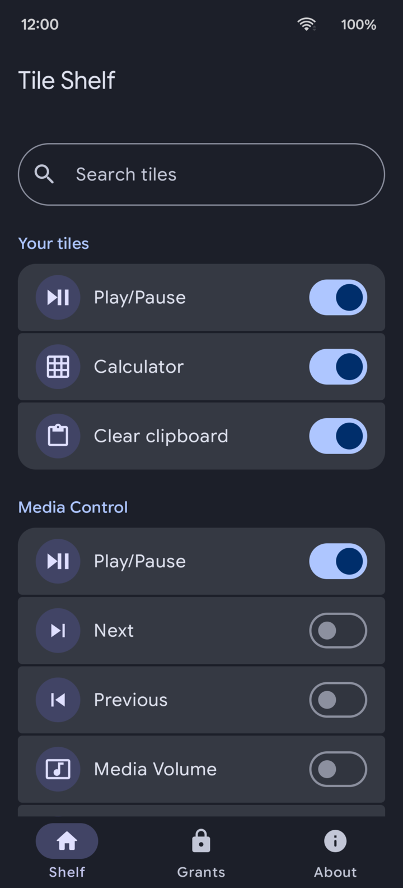
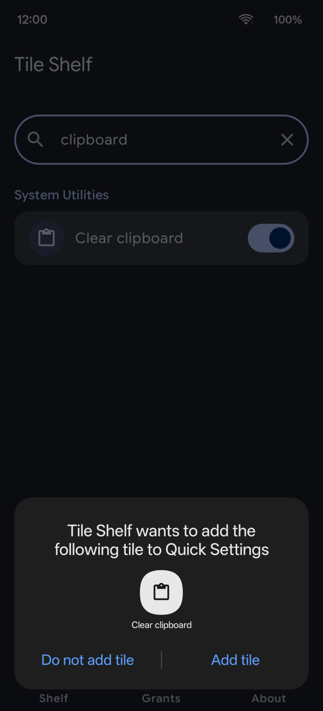
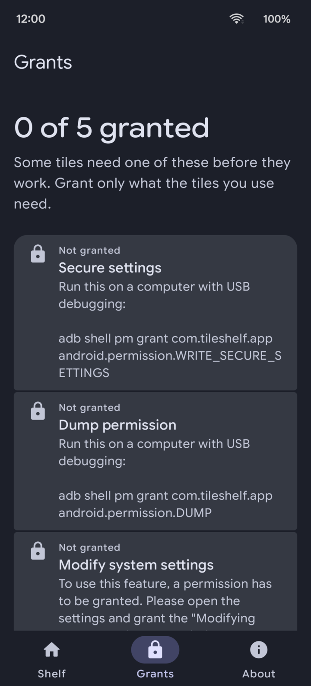

Tile Shelf adds the Quick Settings tiles Android left out, more than 50 of them: media controls, shortcuts to settings pages, screen and sound toggles, developer switches, and a tile that clears the clipboard. It runs on Android 7 and later.

Tile Shelf has no ads, no analytics and no advertising id. It does not use root.

<p>



</p>

Left, the shelf with the tiles you turned on at the top. Middle, Android offering to add a tile to Quick Settings. Right, the Grants tab, which shows the permissions some tiles need.

## Adding a tile

Turn a tile on in Tile Shelf and it appears in the Quick Settings editor. On Android 13 and later the system then asks whether to add the tile to Quick Settings, and you choose. On older versions, add it from the Quick Settings editor yourself. Tile Shelf never places a tile without your confirmation.

## Tiles

Most tiles need nothing beyond the app. Some change system settings and need a one-time permission, and a few need a permission that only adb can grant. Tile Shelf shows what each tile needs and walks you through it.

| Tile | Grant |
| --- | --- |
| Play/Pause, Next, Previous, Media volume, Volume panel | None |
| New alarm, New timer, New event, Make call, Take photo, Record video, Calculator, File manager | None |
| Custom app, five slots | None. Pick the app in Tile Shelf before the tile can open it. |
| Search settings, Languages, Personal dictionary, Privacy, Display, Home app, Notification history, VPN, Data usage, Screen cast, Connected devices, About phone, Developer options, Battery | None |
| Clear clipboard | None |
| Counter | None. Reset the count from the tile's detail screen. |
| Screen timeout, Adjust brightness, Adaptive brightness, Vibrate on calls | One-time Modify system settings |
| Keep screen on | Modify system settings and an adb grant of `WRITE_SECURE_SETTINGS`. The detail screen chooses AC, USB, wireless, or any power source. |
| Switch volume modes, Switch between loud and silence | One-time Do Not Disturb access |
| USB debugging, Heads-up, Force rotation, Fix rotation, Animator duration, Disable all animations, Always finish activities | adb grant of `android.permission.WRITE_SECURE_SETTINGS` |
| Demo mode | adb grants of `WRITE_SECURE_SETTINGS` and `DUMP` |
| Screenshot, Lock screen, Split screen, Power menu | Enable the Tile Shelf accessibility service. Screenshot and lock screen appear from API 28. |
| Grayscale | adb `WRITE_SECURE_SETTINGS`. The row is hidden from API 30 up unless it was already on, in which case you can only turn it off. |
| Show taps | Not offered. A stored on value can only be turned off. Writing `show_touches` throws on this targetSdk. |

To grant the adb permissions, connect the phone with USB debugging on and run:

```sh
adb shell pm grant com.tileshelf.app android.permission.WRITE_SECURE_SETTINGS
adb shell pm grant com.tileshelf.app android.permission.DUMP
```

Some brands block `pm grant` from adb until you flip a switch in Developer options, and fail with a SecurityException otherwise: on OnePlus, Oppo and Realme it is Disable permission monitoring, and on Xiaomi, Redmi and Poco it is USB debugging (Security settings).

Android 13 and later restrict the accessibility switch for apps installed outside an app store, including installs from adb or a downloaded APK. On stock Android, open App info for Tile Shelf, tap the menu, choose Allow restricted settings, then turn on Tile Shelf under Accessibility. ColorOS 16 (OnePlus, Oppo, Realme) has no such option, and the system turns the service back off, so the screenshot, power menu, split screen and lock screen tiles only work there when Tile Shelf comes from a store.

Some ColorOS 16 builds also no longer have Disable permission monitoring, and then the adb grants above cannot be given without root.

Clear clipboard calls `ClipboardManager.clearPrimaryClip()` from the tile service on API 28 and above. On older APIs, and if that call throws, it sets an empty clip. Keyboard clipboard histories, including Gboard and the OnePlus and Samsung keyboards, keep their own copies, and an app cannot clear those.

## Limits

Turning a tile on does not add it to Quick Settings by itself. If you decline the add prompt, or you are on Android 12 or older, add it from the Quick Settings editor. Android may stop showing the prompt for a tile you have declined several times.

Turning a tile off does not undo the system setting that tile last wrote.

A failed grant leaves the switch off. Grant the permission, then turn the tile on again.

## Build

You need JDK 21 and Android SDK platform 37.

```sh
./gradlew :app:assembleDebug
./gradlew :app:testDebugUnitTest
./gradlew :app:recordRoborazziDebug
```

The debug APK is `app/build/outputs/apk/debug/app-debug.apk`. Roborazzi writes the screenshot matrix to `app/screenshots/matrix/`.

`compileSdk` is 37 because Material 3 Expressive (`androidx.compose.material3:material3:1.5.0-beta02`) and the Compose 1.12 libraries it pulls in require it. `targetSdk` is 36 and `minSdk` is 24.

## Credits and license

Tile Shelf is based on [QuickTiles](https://gitlab.com/flxholle/quick-tiles) 1.8, written by asdoi and maintained by flxholle (Felix Hollederer), with help from its contributors. Most of the tile services come from QuickTiles, and its full history is kept in this repository. Tile Shelf is not the official QuickTiles app and is not affiliated with its authors.

QuickTiles in turn used code from Dev-Tiles by Mustafa Ali (Apache-2.0), Dev-QuickSettings by Adrián García (Apache-2.0), Adaptive Brightness Tile and PowerButtonTile by rascarlo (GPL-3.0), and Greyscale by fei-ke (Apache-2.0). Files from those projects keep their own license headers. The split-screen icon is by Smashicons from Flaticon.

Tile Shelf is free software under the GNU General Public License, version 3 or later. See `LICENSE` for the license and `NOTICE` for what changed from QuickTiles.
